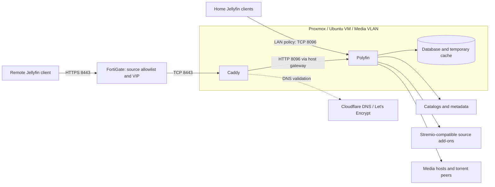

# Polyfin Setup Guide

This guide documents a working Polyfin homelab deployment for on-demand streaming to Jellyfin clients, using a dedicated Ubuntu VM on Proxmox. Adapt the example to your own equipment to browse movie and television catalogs and stream without maintaining a permanent downloaded library.

[Polyfin](https://github.com/moodiness/polyfin) handles accounts, buffering, transcoding, and the Jellyfin-compatible API. Cinemeta supplies catalogs and metadata; Stremio-compatible add-ons supply playable sources. TVs use Jellyfin clients; no separate Jellyfin server is required.

In this homelab, Caddy provides HTTPS using Cloudflare DNS validation. A dedicated media VLAN and FortiGate policies separate the VM from other systems, with a Cisco switch carrying the VLAN. Remote clients connect on TCP **8443**, leaving existing services on public ports 80 and 443 independent. FortiGate, Cisco, Proxmox, and Cloudflare are choices for this deployment, not mandatory Polyfin dependencies. The diagram shows this example topology:



## Before you begin

Polyfin needs a suitable host, persistent storage for its database and configuration, space for its streaming cache, network access to your chosen catalogs and sources, and a reachable address for clients. The supplied deployment uses Docker Engine and the Compose plugin, embedded PostgreSQL, and a persistent `POLYFIN_SECRET_KEY`. These software and storage needs are separate from the brand of router, switch, hypervisor, or DNS provider you use.

To reproduce this homelab exactly, use a Proxmox VE host, administrative access to a FortiGate and Cisco managed switch, an Ubuntu Server 24.04 ISO, and a Cloudflare-managed domain. You can instead use another suitable Docker host, including a physical Linux machine or a VM on another hypervisor, and adapt the networking to your own router and switch. A dedicated VM and media VLAN are isolation choices; Polyfin does not require them.

Steps 12–14 describe this example's optional remote HTTPS setup. Its direct port-forwarding approach needs an internet connection that accepts inbound connections; local playback does not. Cloudflare and Caddy support the supplied HTTPS configuration, but you can use another DNS provider and HTTPS setup with the corresponding configuration changes. Keep the example VM separate from production applications when following this layout.

Replace these examples consistently with your own values. The public IPs are documentation-only addresses.

| Item | Example used throughout |
| --- | --- |
| Trusted LAN | `192.168.10.0/24` |
| Administration workstation | `192.168.10.50` |
| Existing Proxmox management IP | `192.168.10.10` |
| FortiGate LAN / WAN interfaces | `internal` / `wan1` |
| New FortiGate VLAN interface | `media` |
| Media VLAN / subnet | `50` / `192.168.50.0/24` |
| Media gateway | `192.168.50.1` |
| Media DHCP pool | `192.168.50.100` through `192.168.50.199` |
| Reserved Ubuntu VM address | `192.168.50.10` |
| Ubuntu username / hostname | `mediaadmin` / `polyfin` |
| Public WAN address | `203.0.113.10` |
| Allowed remote household public IP | `198.51.100.25` |
| Cloudflare zone / media hostname | `example.com` / `tv.example.com` |

If following the VLAN example, identify the switch ports connected to your router and media host (the FortiGate and Proxmox host here). Preserve their existing native VLAN and PVIDs.

Follow the applicable numbered steps in order. Adapt or skip the equipment-specific steps when your existing host or network already provides the needed connectivity. Network device instructions below use this homelab's web interfaces; shell commands run on its Ubuntu VM unless another location is named. On another host OS, use its equivalent installation and administration commands.

## 1. Create the FortiGate media VLAN and DHCP server

This optional isolation example uses FortiGate for routing and DHCP. On other equipment, configure equivalent addressing and isolation if desired; an existing suitable subnet can be used without creating a media VLAN.

On the FortiGate, open **Network > Interfaces > Create New > Interface**. Configure:

| Setting | Value |
| --- | --- |
| Name / type | `media` / VLAN |
| Parent interface | `internal`, the interface carrying the switch trunk |
| VLAN ID | `50` |
| Role | LAN |
| Addressing mode | Manual |
| IP/netmask | `192.168.50.1/24` |
| Administrative access | None |
| DHCP server | Enabled |
| DHCP address range | `192.168.50.100-192.168.50.199` |
| DHCP default gateway | Same as interface: `192.168.50.1` |
| DHCP DNS servers | Specify `1.1.1.1` and `1.0.0.1` |

Save the interface. Substitute your trunk-facing interface for `internal` if needed. This interface provides the gateway and DHCP settings; firewall policies provide isolation. Select **LAN** to expose DHCP controls in the GUI.

## 2. Create firewall objects and allow outbound internet access

These are FortiGate instructions for the example VLAN. With another router or firewall, adapt its rules to allow the host to reach DNS, catalogs, and media sources while preserving your intended isolation. The named objects and `ALL` service policy below are this homelab's configuration, not Polyfin prerequisites.

### Create address objects

Open **Policy & Objects > Addresses > Create New > Address**. Create these **Subnet** objects with interface association **any**:

| Object name | IP/netmask | Purpose |
| --- | --- | --- |
| `Media-Net` | `192.168.50.0/24` | Media subnet for outbound traffic |
| `Polyfin-VM` | `192.168.50.10/32` | Only the media VM |
| `Home-LAN` | `192.168.10.0/24` | Home clients |
| `Admin-PC` | `192.168.10.50/32` | SSH administration workstation |

A `/32` matches one host. Use **Subnet**, not **IP Range**, when entering these values.

### Create the outbound policy

Open **Policy & Objects > Firewall Policy > Create New**:

| Setting | Value |
| --- | --- |
| Name | `Media-to-Internet` |
| Incoming interface | `media` |
| Outgoing interface | `wan1`, or your existing internet-facing SD-WAN zone |
| Source | `Media-Net` |
| Destination | `all` |
| Service | `ALL` |
| NAT | Enabled; use outgoing interface address |
| Action / schedule | ACCEPT / always |
| Log allowed traffic | All sessions |

Save above applicable deny rules. Source NAT provides internet access; `ALL` permits DNS, HTTPS, and variable torrent peer ports. The outgoing interface limits this policy to the WAN.

Do not add a general media-to-internal allow rule. Unmatched inter-VLAN traffic is denied; remove or narrow any existing broad policy that would allow the media subnet into other internal networks. Replies to permitted connections are handled automatically by the stateful firewall.

## 3. Allow home clients and SSH administration

For this routed VLAN layout, the FortiGate rules below allow clients to reach Polyfin and the administrator to reach SSH. Use equivalent controls on your network as needed. SSH is this guide's administration method, and port 8443 is for its optional HTTPS proxy; neither is required for local Polyfin playback.

### Create the application services

Open **Policy & Objects > Services > Create New > Service**. Create:

| Service name | Protocol type | TCP destination port | UDP destination port |
| --- | --- | --- | --- |
| `Polyfin-8096` | TCP/UDP/SCTP | Low `8096`, high `8096` | Blank |
| `Polyfin-HTTPS-8443` | TCP/UDP/SCTP | Low `8443`, high `8443` | Blank |

Leave the service's address restriction at its default (`0.0.0.0` if shown) and source ports unrestricted. The firewall policy's destination object selects the VM. Use the built-in **SSH** service for TCP 22.

### Create the internal policies

Under **Policy & Objects > Firewall Policy**, create both policies below. Set the schedule to **always** and enable allowed-traffic logging.

| Setting | `LAN-to-Polyfin` | `Admin-to-Polyfin` |
| --- | --- | --- |
| Incoming interface | `internal` | `internal` |
| Outgoing interface | `media` | `media` |
| Source | `Home-LAN` | `Admin-PC` |
| Destination | `Polyfin-VM` | `Polyfin-VM` |
| Service | `Polyfin-8096`, `Polyfin-HTTPS-8443` | SSH |
| NAT | Disabled | Disabled |
| Action | ACCEPT | ACCEPT |

These rules allow LAN playback and HTTPS testing, with SSH limited to the administration workstation. Keep source NAT disabled for internal routing. Substitute the actual incoming interface if these devices are on another network.

## 4. Carry the VLAN through the Cisco switch

This step applies when carrying the example VLAN through a managed switch. Cisco hardware is not required: use your switch's equivalent VLAN controls, or skip this step if you are not using tagged VLANs.

On a Cisco SG300:

1. Open **VLAN Management > Create VLAN**, add VLAN ID **50**, name it **Media**, and apply.
2. Open **VLAN Management > Interface Settings**. Ensure the FortiGate uplink and Proxmox-facing port can carry tagged VLANs using **Trunk** or the existing **General** mode. Preserve their existing native VLAN/PVID.
3. Open **VLAN Management > Port to VLAN**, select VLAN **50**, and apply these memberships:

| Port role | VLAN 50 membership | Existing native/management VLAN |
| --- | --- | --- |
| Uplink toward FortiGate | Tagged | Preserve |
| Port toward media Proxmox host | Tagged | Preserve untagged membership |
| Any intermediate switch uplinks | Tagged | Preserve |

Click **Apply**, then **Save** to copy the running configuration to startup configuration.

Keep the Proxmox-facing port's management VLAN untagged and VLAN 50 tagged. See Cisco's [Port to VLAN guide](https://www.cisco.com/c/en/us/td/docs/switches/lan/csb_switching_general/olh/Sx300/1-3-0/en/port_to_vlan.html).

## 5. Enable VLAN awareness on the Proxmox bridge

This step is specific to the Proxmox VLAN example. Use the equivalent virtual networking settings on another hypervisor, or skip it for a physical host or a deployment without tagged VM traffic.

In Proxmox, select the **node**, then **System > Network > vmbr0 > Edit**:

1. Enable **VLAN aware**.
2. Ensure **VLAN IDs** includes `50`; an existing range of `2-4094` includes it.
3. Leave the management IP, gateway, and bridge port unchanged.
4. Save and click **Apply Configuration**, with console access available in case the connection briefly drops.
5. Confirm the Proxmox interface still opens at `https://192.168.10.10:8006`.

The bridge now carries tagged VM traffic alongside host management traffic, as described in the [Proxmox network documentation](https://github.com/proxmox/pve-docs/blob/master/pve-network.adoc).

## 6. Create the Ubuntu VM and assign its VLAN

The following creates this homelab's Docker host. Proxmox and an Ubuntu VM are optional deployment choices. If you already have a suitable host, use it and adapt the later commands and addresses. The CPU, memory, and disk values below are starting allocations for this example, not Polyfin minimum requirements; size your host for its workload.

If reusing a dedicated Ubuntu VM, take a snapshot first and update its network device using the settings below. Otherwise, upload the Ubuntu Server 24.04 ISO to Proxmox storage under **ISO Images > Upload**, then click **Create VM**:

| Wizard setting | Value |
| --- | --- |
| Name | `polyfin` |
| OS | Ubuntu Server 24.04 ISO |
| System | Defaults; enable QEMU Guest Agent support |
| Disk | 64 GB on storage with enough free space |
| CPU | 2 cores initially |
| Memory | 4096 MiB initially |
| Network bridge | `vmbr0` |
| Network model | VirtIO |
| VLAN tag | `50` |

For an existing VM, set the same bridge/model/tag under **Hardware > Network Device > Edit** and retain its MAC address. If Proxmox firewall rules are active, permit the same guest ports as the FortiGate policies: TCP 22 from the admin workstation and TCP 8096/8443 from the intended clients.

Start the VM and open its **Console**. In the Ubuntu installer:

1. Leave the VirtIO interface, normally `ens18`, on automatic **DHCPv4**.
2. Install Ubuntu onto the VM's virtual disk using the guided storage layout.
3. Set hostname `polyfin`, create user `mediaadmin`, and choose a strong password.
4. Select **Install OpenSSH server**, complete the installation, and reboot from the virtual disk.

In this configuration, do not create an `ens18.50` VLAN inside Ubuntu; Proxmox already applies the tag. On other hosts, apply tagging only where your network design needs it. Add CPU or storage later if your transcoding and cache requirements need it.

### Reserve the VM's DHCP address

Use your DHCP server's reservation feature or another suitable stable addressing method. The following reservation procedure uses Proxmox and FortiGate; DHCP reservations from these products are not a Polyfin requirement.

Copy the VM's MAC address from **Proxmox > VM > Hardware > Network Device**. In **FortiGate > Network > Interfaces > media > Edit**, expand the DHCP settings and add an **IP address assignment rule / reservation** mapping that MAC to `192.168.50.10`. Save the reservation after checking that `.10` is unused. Keep the dynamic pool at `.100-.199`; [FortiGate supports reservations outside that pool within the same subnet](https://community.fortinet.com/fortigate-3/technical-tip-dhcp-reservation-outside-the-dhcp-range-but-within-the-subnet-212937).

Reboot the Ubuntu VM from its console to obtain the reserved address. For a reused VM with a static address, edit its existing `/etc/netplan/*.yaml` configuration so the actual interface uses `dhcp4: true`, removing the old static address and default route. Apply with `sudo netplan try` from the Proxmox console. Do not create a second conflicting interface definition.

## 7. Verify networking before installing services

Verify your host's address, routing, DNS, and outbound access regardless of equipment. The commands below target this Ubuntu VM; `qemu-guest-agent` is for integration with the example hypervisor and can be omitted on hosts that do not use it. The Cloudflare URL is only an HTTPS connectivity test, not a requirement to use Cloudflare services.

In the Ubuntu console, run:

```bash
ip -4 addr show
ip route
resolvectl status
sudo apt update
sudo apt install -y curl qemu-guest-agent
sudo systemctl start qemu-guest-agent
curl -I --max-time 10 https://www.cloudflare.com
```

Confirm the interface has `192.168.50.10/24`, the default route uses `192.168.50.1`, and DNS is configured. An HTTP response from the final command confirms outbound DNS and HTTPS access.

From your administration workstation, connect:

```bash
ssh mediaadmin@192.168.50.10
```

Continue over SSH once connected. For failures in this example, check VLAN tags for DHCP, `Media-to-Internet` and NAT for internet access, or `Admin-to-Polyfin` for SSH; on other networks, check the equivalent routing and access controls. Ports 8096 and 8443 remain closed until their services start.

## 8. Install Docker

Docker Engine and the Compose plugin are needed to run the supplied Compose files. The commands below use the [official Docker repository](https://docs.docker.com/engine/install/ubuntu/) on a fresh Ubuntu host, whether physical or virtual. Use the appropriate Docker installation instructions for a different host OS:

```bash
sudo apt update
sudo apt install -y ca-certificates curl git openssl nano
sudo install -m 0755 -d /etc/apt/keyrings
sudo curl -fsSL https://download.docker.com/linux/ubuntu/gpg \
  -o /etc/apt/keyrings/docker.asc
sudo chmod a+r /etc/apt/keyrings/docker.asc

sudo tee /etc/apt/sources.list.d/docker.sources >/dev/null <<EOF
Types: deb
URIs: https://download.docker.com/linux/ubuntu
Suites: $(. /etc/os-release && echo "${UBUNTU_CODENAME:-$VERSION_CODENAME}")
Components: stable
Architectures: $(dpkg --print-architecture)
Signed-By: /etc/apt/keyrings/docker.asc
EOF

sudo apt update
sudo apt install -y docker-ce docker-ce-cli containerd.io docker-buildx-plugin docker-compose-plugin
sudo systemctl enable --now docker
sudo docker run --rm hello-world
sudo docker compose version
```

Confirm the test container succeeds and Compose reports its version. For an existing Docker installation, run these checks without reinstalling. The commands use `sudo`; Docker group membership is unnecessary.

## 9. Copy the repository and prepare secrets

Copy the files to your chosen Docker host; the VM, username, and paths below are examples. `POLYFIN_SECRET_KEY` belongs to Polyfin's configuration. `CLOUDFLARE_API_TOKEN` is only needed by the optional Caddy/Cloudflare setup, not by Polyfin itself.

From a workstation with this repository downloaded, open a terminal in the directory containing `polyfin-homelab` and copy it to the VM:

```bash
scp -r polyfin-homelab mediaadmin@192.168.50.10:~/
```

Alternatively, clone your own published copy onto the VM. In the VM's SSH session, enter the directory and initialize its environment file:

```bash
cd ~/polyfin-homelab
cp .env.example .env
chmod 600 .env
openssl rand -hex 32
nano .env
```

Paste the generated value after `POLYFIN_SECRET_KEY=`. Save in nano with **Ctrl+O**, **Enter**, then exit with **Ctrl+X**. Leave the Cloudflare token blank unless following step 12. Keep the encryption key for the lifetime of the deployment and with your backups; never commit `.env`.

Run remaining shell commands from **`~/polyfin-homelab`**. Compose reads secrets from the root `.env`; build and volume paths resolve relative to each Compose file.

## 10. Start Polyfin and create the administrator

This step runs Polyfin independently of the example's router, switch, hypervisor, and optional HTTPS proxy. Substitute your host's address in the browser URLs. The supplied Compose file publishes port 8096; keep any changes to that mapping consistent with your client and proxy settings.

Check that port 8096 is free:

```bash
sudo ss -ltnp | grep ':8096'
```

No output means nothing is listening on that port. If a native Jellyfin service owns it and you are replacing that service, stop and disable it without deleting its data:

```bash
sudo systemctl disable --now jellyfin
```

For a containerized Jellyfin installation, stop the old container through its own Compose project instead. Then start Polyfin:

```bash
sudo docker compose --env-file .env -f docker/polyfin/compose.yaml config --quiet
sudo docker compose --env-file .env -f docker/polyfin/compose.yaml up -d
sudo docker compose --env-file .env -f docker/polyfin/compose.yaml ps
sudo docker compose --env-file .env -f docker/polyfin/compose.yaml logs --tail=50 polyfin
```

From a browser on the trusted LAN, open `http://192.168.50.10:8096/admin/`. Enter the initial setup code shown in the logs, choose an administrator name and password, and create the account. If the code is outside the last 50 lines, retrieve it with:

```bash
sudo docker compose --env-file .env -f docker/polyfin/compose.yaml logs polyfin \
  | grep -i 'setup code'
```

The supplied Compose file runs Polyfin with embedded PostgreSQL and a persistent `/data` volume. Its networking setting is intentional:

```yaml
services:
  polyfin:
    network_mode: bridge
```

This uses Docker's built-in bridge rather than the user-defined network Compose normally creates. It avoids the embedded `127.0.0.11` resolver, which Polyfin's network-interface torrent route skips for tracker lookups. Check the resolver before testing playback:

```bash
sudo docker compose --env-file .env -f docker/polyfin/compose.yaml exec polyfin cat /etc/resolv.conf
```

For this torrent route, expect reachable non-loopback nameservers, such as the `1.1.1.1` and `1.0.0.1` supplied in this guide; these particular DNS servers are not required. Do not edit this Docker-managed file inside the container. When applying a networking change to an existing deployment, use `up -d --force-recreate` with the same Compose arguments to recreate the container and retain its data volume.

The Polyfin template is adapted from the [official embedded-database Compose configuration](https://github.com/moodiness/polyfin/blob/main/compose.embedded.yaml). Discovery broadcasting is omitted; clients connect using the server address explicitly.

## 11. Configure catalogs, sources, and playback

Use your own host address for the administration interface. The catalog and streaming providers below are the choices used in this example; select compatible sources for your deployment. Torrent settings apply when using torrent sources, rather than being a requirement for every playback source.

### Add catalogs and a streaming provider

In `http://192.168.50.10:8096/admin/`:

1. Open **Content > Sources > Add a source** and select **Stremio addon**.
2. Add Cinemeta using `https://v3-cinemeta.strem.io/manifest.json`.
3. Under **Content > Libraries**, enable the movie and television catalogs you want displayed.
4. Add a compatible streaming add-on using its manifest URL. The setup uses Torrentio (`https://torrentio.strem.fun/manifest.json`); another compatible provider can be used instead.
5. Confirm both add-ons appear as active. A streaming-only add-on does not need to create its own library; it supplies sources for titles in your enabled catalogs.

A catalog entry does not guarantee a playable source: Cinemeta supplies metadata, while the streaming add-on supplies media URLs or torrent information.

### Enable torrent playback and create a viewer account

1. Open **Settings > Torrents**. Select **Network interface** as the route, choose the container's `eth0`, enable **Play torrent streams**, and save. This route uses your normal internet connection; peers can see its public IP.
2. Open **Users**, select your administrator account, and enable **Can play torrent streams** under **Access** so you can test playback.
3. Under **Users**, add a separate user named `viewer` with its own strong password. Leave administrator privileges disabled, allow access to the intended libraries, and enable **Can play torrent streams** for that user too.
4. Open **Web player**, sign in, open a movie library, choose a title, and select a modest 1080p source. Confirm video and audio play, then test seeking.

Posters with no playable versions indicate a source or permission problem. Sources stuck on peer discovery call for checking the container resolver above and outbound firewall logs, rather than opening inbound torrent ports.

Set a cache limit that leaves space for the operating system and database. For richer cast information and artwork, configure your own TMDB API key in **Settings > Content > Images**. Web-player themes affect the browser interface; native TV clients control their own layouts.

## 12. Configure Cloudflare DNS and the API token

This step is for the optional Cloudflare-based HTTPS example. Polyfin itself does not need a Cloudflare account, API token, or public domain for local playback. If using another DNS provider or certificate method, adapt the DNS records and the proxy configuration in step 13 together; the supplied Caddy files specifically use the Cloudflare plugin and token.

In the Cloudflare dashboard, select your zone, then **DNS > Records > Add record**:

| Setting | Value |
| --- | --- |
| Type | A |
| Name | `tv` |
| IPv4 address | `203.0.113.10`, replaced with your real WAN public IP |
| Proxy status | DNS only, gray cloud |
| TTL | Auto |

Save the record. Read the WAN address from your router's internet configuration; do not use the VM's private address. DNS-only mode lets the FortiGate see the remote household's source IP. This guide uses IPv4, so do not add an AAAA record unless you also configure the IPv6 path and access policy.

Next, open **My Profile > API Tokens > Create Token > Create Custom Token**:

| Setting | Value |
| --- | --- |
| Token name | `Polyfin-Caddy` |
| Permission 1 | Zone > DNS > Edit |
| Permission 2 | Zone > Zone > Read |
| Zone resources | Include > Specific zone > `example.com` |

Create the token and copy it into the VM's `.env` file with `nano .env`. These are the scoped permissions required by the [Caddy Cloudflare plugin](https://github.com/caddy-dns/cloudflare); use the token rather than the Global API Key.

Keep the existing `POLYFIN_SECRET_KEY` line and set:

```dotenv
POLYFIN_DOMAIN=tv.example.com
CLOUDFLARE_API_TOKEN=your-scoped-token
```

Replace both example values before saving. Verify public DNS from the VM:

```bash
sudo apt install -y dnsutils
dig @1.1.1.1 +short A tv.example.com
```

The result should be your public WAN address. Wait for DNS propagation if it still returns an older value.

## 13. Build Caddy and test HTTPS locally

Follow this step if using the supplied Caddy/Cloudflare proxy. Caddy, DNS-01 validation, and port 8443 are choices for this homelab's HTTPS endpoint, not Polyfin dependencies. With an existing HTTPS proxy or another certificate setup, configure its equivalent upstream connection and trusted proxy handling. For local playback without this proxy, skip this step and use Polyfin's reachable local address.

The included Dockerfile builds Caddy with the Cloudflare DNS plugin. Compose publishes TCP **8443** and passes `POLYFIN_DOMAIN` and `CLOUDFLARE_API_TOKEN`.

The included Caddyfile reads the hostname and token from those variables:

```caddyfile
{
    auto_https disable_redirects
}

{$POLYFIN_DOMAIN}:8443 {
    tls {
        dns cloudflare {env.CLOUDFLARE_API_TOKEN}
        resolvers 1.1.1.1
    }
    reverse_proxy host.docker.internal:8096
}
```

`host.docker.internal` maps to the VM's Docker host gateway through the Compose `extra_hosts` entry. It reaches Polyfin's published port. Do not replace it with `127.0.0.1`: inside Caddy that means Caddy's own container.

Validate the Compose configuration, then build and start Caddy:

```bash
sudo docker compose --env-file .env -f docker/caddy/compose.yaml config --quiet
sudo docker compose --env-file .env -f docker/caddy/compose.yaml up -d --build
sudo docker compose --env-file .env -f docker/caddy/compose.yaml ps
sudo docker compose --env-file .env -f docker/caddy/compose.yaml logs --tail=50 caddy
```

Look for successful certificate issuance. [DNS-01 validation](https://caddyserver.com/docs/automatic-https#dns-challenge) allows Caddy to obtain and renew certificates without exposing ports 80 or 443. Certificate state is preserved in the `caddy_data` volume. HTTP redirects are disabled, so use the full HTTPS URL including `:8443`.

Test from the VM, substituting your hostname and VM address:

```bash
curl -I --resolve tv.example.com:8443:192.168.50.10 \
  https://tv.example.com:8443/web/
```

Expect `200 OK` without using `-k`. This checks TLS and proxy connectivity before WAN forwarding. For a 502, test `curl -I http://127.0.0.1:8096/web/` on the VM. For certificate errors, check the token, zone scope, and Caddy logs.

For this proxy setup, open Polyfin **Settings > Notifications**, set **Public address** to `https://tv.example.com:8443`, and save. Leave Polyfin's own HTTPS server disabled here because Caddy terminates TLS and forwards HTTP internally. With another setup, use your actual client-facing address and configure TLS at the endpoint you chose.

Configure client-IP handling before opening remote access:

1. On your administration workstation, temporarily add `192.168.50.10 tv.example.com` to its hosts file, substituting your hostname. On Windows, run Notepad as administrator and open `C:\Windows\System32\drivers\etc\hosts` using the **All files** filter. On Linux or macOS, use `sudo nano /etc/hosts`.
2. In that workstation's browser, open `https://tv.example.com:8443` and sign in. The hosts entry sends this request directly to the media VM while preserving the certificate hostname.
3. In Polyfin **Users**, open that user's device list and note the connection address shown for this proxied session. Enter that address under **Settings > Security > Known proxies**, then save and sign in again. Use the address Polyfin actually sees, which may be a Docker gateway address; do not trust the whole home or media subnet.
4. Remove the temporary hosts entry after the local test. Recheck the proxy address after Docker network changes.

This lets Polyfin use Caddy's forwarded client address. The [upstream reverse-proxy guide](https://github.com/moodiness/polyfin/blob/main/docs/reverse-proxy.md) explains the header handling.

## 14. Create the FortiGate VIP and remote access policy

This optional step implements direct remote access with a FortiGate port forward and source-IP allowlist. On another router or firewall, use its equivalent destination NAT and access rules for your chosen HTTPS endpoint. FortiGate VIPs and public port forwarding are not required for local playback; skip this step if remote access is unnecessary or already provided through another suitable access path.

### Create the remote source address

Obtain the remote household's current public IPv4 address from a device on that household's normal internet connection. On the FortiGate, open **Policy & Objects > Addresses > Create New > Address**. Set name **Remote-Household**, type **Subnet**, and IP/netmask **`198.51.100.25/32`**, replacing the example with that public address. Save it.

### Create the port-forwarding VIP

Open **Policy & Objects > Virtual IPs > Create New > Virtual IP**:

| Setting | Value |
| --- | --- |
| Name | `Polyfin-HTTPS-VIP` |
| Interface | `wan1` |
| External IP address | `203.0.113.10`, your real WAN public IP |
| Mapped IP address | `192.168.50.10` |
| Port forwarding | Enabled |
| Protocol | TCP |
| External service port | 8443 |
| Map to IPv4 port | 8443 |

Save the VIP. It translates WAN TCP 8443 to Caddy's TCP 8443 on the VM. It does not grant access by itself.

Existing services can retain their own TCP 80/443 mappings. If FortiGate reports an overlap, inspect existing VIPs on the same public IP. An all-port VIP must be replaced or narrowed to that application's required ports, with its policy destinations updated accordingly. Preserve every port that application needs, including certificate validation or redirects. Different hostnames alone do not distinguish these port-forwarding rules. [Fortinet's VIP guidance](https://community.fortinet.com/t5/FortiGate/Technical-Tip-Virtual-IP-VIP-port-forwarding-configuration/ta-p/198143) describes the destination mapping.

### Permit the remote connection

Open **Policy & Objects > Firewall Policy > Create New**:

| Setting | Value |
| --- | --- |
| Name | `WAN-to-Polyfin` |
| Incoming interface | `wan1` |
| Outgoing interface | `media` |
| Source | `Remote-Household` |
| Destination | `Polyfin-HTTPS-VIP`, not the `Polyfin-VM` address object |
| Service | `Polyfin-HTTPS-8443`, created in step 3 |
| NAT | Disabled |
| Action / schedule | ACCEPT / always |
| Log allowed traffic | All sessions |

Save above matching deny policies. The VIP supplies **destination NAT**; the policy's **source NAT** stays disabled. Do not forward TCP 8096 or SSH from the WAN.

### Test from the allowed external network

From a device connected to the remote household's network, open:

```text
https://tv.example.com:8443/web/
```

Confirm the login page loads with a trusted certificate, sign in as `viewer`, and play a title. If it times out in this example, check **Log & Report > Forward Traffic** on the FortiGate for the source IP, destination port 8443, and matching policy. Confirm the VIP and policy are both enabled and the remote public IP matches `Remote-Household`. On other equipment, check the corresponding forwarding rules, access controls, and logs.

Test WAN access from the allowed remote network; LAN access through the public IP depends on hairpin NAT. Include `:8443` in the URL when using this example's port mapping, or substitute your chosen HTTPS port.

## 15. Connect Jellyfin smart TV clients

Roku and LG webOS are example clients, not required TV hardware. Use a compatible Jellyfin client or Polyfin's web player and enter the address reachable from that device. Substitute your host and, if configured, your remote HTTPS endpoint in the instructions below.

1. Connect the TV to its home network using Ethernet or Wi-Fi.
2. On Roku, open **Streaming Store / Streaming Channels**, search for **Jellyfin**, and install it. On LG webOS, find **Jellyfin** in the TV's app store and install it.
3. Choose **Add server** or **Connect to server**. At home, enter `http://192.168.50.10:8096`; remotely, enter `https://tv.example.com:8443`.
4. Sign in with the `viewer` account created in step 11.
5. Open a movie or television library, select a title and source, then play it. Try pausing, seeking, resuming, audio-track selection, and subtitles.

Enter the server manually for this example because discovery broadcasts do not normally cross VLANs. The client needs connectivity to Polyfin, regardless of the router, switch, hypervisor, or DNS provider used.

## 16. Backups, maintenance, and updates

The retention schedule, SFTP destination, and VM backups below are example backup choices. Preserve Polyfin's data and encryption key using a backup method suitable for your host; an SFTP server or Proxmox VM backup is not a runtime dependency. Back up proxy state too if you deploy a proxy.

In Polyfin **Settings > Backups**, enable **Back up the database every day**, choose a daily time, and retain seven backups to start. The default folder is `/data/backups` in the persistent volume. Under **System > Schedule**, use **Back up now** in the database backups panel and confirm it completes.

For an off-host copy using this example's SFTP approach, open **Settings > Backups > Destinations > Add a destination**. Select your existing SFTP backup server, enter its hostname, port, account credentials, and destination folder, then use **Test** and save. Run another backup and confirm the destination upload succeeds. Preserve `.env`, especially `POLYFIN_SECRET_KEY`, in your secure backup storage, and include Caddy's persistent volumes in host or VM backups if using Caddy. See the [Polyfin backup and restore guide](https://github.com/moodiness/polyfin/blob/main/docs/backups.md) for restore procedures.

To update Polyfin:

```bash
sudo docker compose --env-file .env -f docker/polyfin/compose.yaml pull
sudo docker compose --env-file .env -f docker/polyfin/compose.yaml up -d
```

If using the supplied HTTPS setup, rebuild Caddy and its Cloudflare DNS plugin with:

```bash
sudo docker compose --env-file .env -f docker/caddy/compose.yaml build --pull --no-cache
sudo docker compose --env-file .env -f docker/caddy/compose.yaml up -d
```

Back up before updates, then check logs, HTTPS, and playback. The examples use moving image tags for convenience; pin tested image digests and plugin versions when you need repeatable upgrades. Avoid `docker compose down -v`, which deletes persistent volumes.

Keep your host OS patched (Ubuntu in this example), monitor free disk space, and update the remote source-IP allowlist if you use one and the household's public IP changes. Docker-published ports need network-level filtering; do not rely on UFW alone to restrict them.

## Further reading

- [Networking and firewall configuration](docs/networking.md)
- [Troubleshooting](docs/troubleshooting.md)
- [Polyfin documentation](https://moodiness.github.io/polyfin/)
- [Jellyfin clients](https://jellyfin.org/downloads/clients/)

## License

[MIT](LICENSE). This repository documents a deployment and provides configuration examples; Polyfin and the other components remain separate upstream projects.
