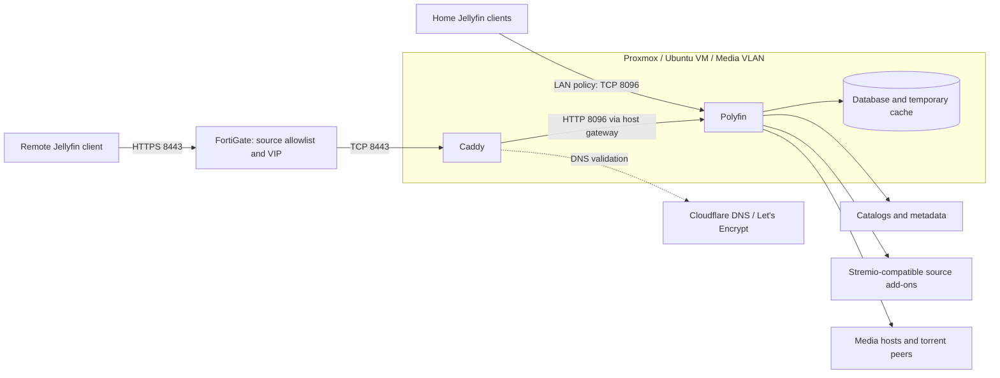

# Polyfin Homelab

A self-hosted, on-demand streaming setup for Jellyfin clients, running on a dedicated Ubuntu VM in Proxmox. Browse movie and television catalogs, select a source, and stream without maintaining a permanent downloaded media library.

[Polyfin](https://github.com/moodiness/polyfin) provides the Jellyfin-compatible server API, accounts, buffering, and transcoding. Cinemeta supplies catalogs and metadata; Stremio-compatible add-ons supply playable sources. The TV runs a Jellyfin client. A separate Jellyfin server is not required.

Caddy provides HTTPS using Cloudflare DNS validation. A dedicated media VLAN and FortiGate policies separate the VM from other systems. Remote clients connect on TCP **8443**, leaving existing services on public ports 80 and 443 independent.



## Prerequisites

- Proxmox VE and an Ubuntu Server 24.04 VM with SSH access.
- A reasonable starting allocation: 2 vCPUs, 4 GB RAM, and a 64 GB disk. Allow more CPU for software transcoding and enough disk space for the selected cache size.
- A FortiGate firewall and Cisco managed switch carrying a dedicated media VLAN.
- A Cloudflare-managed domain and an internet connection with inbound reachability for remote access.
- A Jellyfin client on your smart TV, such as LG webOS or Roku.
- Compatible streaming sources you are authorized to use.

All network addresses in this repository are examples. The guide uses **VLAN 50**, VM **192.168.50.100**, and hostname **tv.example.com**. Replace them with your own values.

## 1. Prepare the VM and network

Create or reuse a dedicated Ubuntu VM on the media Proxmox host. Keep it separate from production applications. Use a VirtIO network adapter on `vmbr0` and configure DHCP in Ubuntu.

Follow [Networking](docs/networking.md) to create the VLAN, carry it through the switch, enable VLAN awareness on the bridge, and assign the VM's VLAN tag. Keep the Proxmox management address and native VLAN unchanged.

Before installing services, confirm the VM has its media address, a default route, DNS, and internet access:

```bash
ip -4 addr show
ip route
resolvectl status
curl -I --max-time 10 https://www.cloudflare.com
```

Reserve the VM's address in DHCP. Allow SSH from your administration workstation and TCP 8096 from your home network.

## 2. Install Docker

On a fresh Ubuntu VM, install Docker Engine and the Compose plugin using the [official Docker repository](https://docs.docker.com/engine/install/ubuntu/):

```bash
sudo apt update
sudo apt install -y ca-certificates curl git openssl
sudo install -m 0755 -d /etc/apt/keyrings
sudo curl -fsSL https://download.docker.com/linux/ubuntu/gpg \
  -o /etc/apt/keyrings/docker.asc
sudo chmod a+r /etc/apt/keyrings/docker.asc

sudo tee /etc/apt/sources.list.d/docker.sources >/dev/null <<EOF
Types: deb
URIs: https://download.docker.com/linux/ubuntu
Suites: $(. /etc/os-release && echo "${UBUNTU_CODENAME:-$VERSION_CODENAME}")
Components: stable
Architectures: $(dpkg --print-architecture)
Signed-By: /etc/apt/keyrings/docker.asc
EOF

sudo apt update
sudo apt install -y docker-ce docker-ce-cli containerd.io docker-buildx-plugin docker-compose-plugin
sudo docker run --rm hello-world
sudo docker compose version
```

If Docker is already installed, use the existing installation after checking that Compose is available.

## 3. Start Polyfin

Copy or clone this repository onto the Ubuntu VM. Run all subsequent shell commands from the `polyfin-homelab` repository root.

```bash
cp .env.example .env
chmod 600 .env
openssl rand -hex 32
nano .env
```

Paste the generated value into `POLYFIN_SECRET_KEY`. Keep it for the lifetime of the deployment: Polyfin uses it to encrypt stored secrets. The Cloudflare fields can be completed in step 5. Never commit `.env`.

Check that port 8096 is free:

```bash
sudo ss -ltnp | grep ':8096'
```

If an old Jellyfin installation owns the port, see [Port conflicts](docs/troubleshooting.md#jellyfin-and-polyfin-port-conflicts).

```bash
sudo docker compose --env-file .env -f docker/polyfin/compose.yaml config --quiet
sudo docker compose --env-file .env -f docker/polyfin/compose.yaml up -d
sudo docker compose --env-file .env -f docker/polyfin/compose.yaml logs --tail=50 polyfin
```

Open `http://192.168.50.100:8096/admin/`. Use the initial setup code shown in the logs to create your administrator account.

The Compose file runs Polyfin with embedded PostgreSQL and a persistent `/data` volume. It uses `network_mode: bridge` to avoid Docker's embedded loopback DNS resolver, which interfered with torrent tracker lookups in network-interface mode. See [Docker DNS and peer discovery](docs/troubleshooting.md#docker-dns-and-torrent-peer-discovery).

The Polyfin template is adapted from the [official embedded-database Compose configuration](https://github.com/moodiness/polyfin/blob/main/compose.embedded.yaml). Discovery broadcasting is omitted; clients connect using the server address explicitly.

## 4. Configure catalogs and streaming sources

In the Polyfin administrator interface:

1. Open **Content → Sources → Add a source** and select **Stremio addon**.
2. Add Cinemeta using `https://v3-cinemeta.strem.io/manifest.json`.
3. Under **Content → Libraries**, enable the movie and television catalogs you want displayed.
4. Add a compatible streaming add-on using its manifest URL. The setup uses Torrentio (`https://torrentio.strem.fun/manifest.json`); another compatible provider can be used instead.
5. Open the web player and test a title supported by your source provider.

**Catalogs and streams are separate.** Cinemeta provides titles, posters, and metadata; a streaming add-on supplies media URLs or torrent information. A catalog entry alone does not guarantee a playable source.

For torrent sources, open **Settings → Torrents**, enable **Play torrent streams**, select the **Network interface** route, and choose the container's `eth0`. Under **Users → Access**, enable **Can play torrent streams** for each intended user. This route uses your normal internet connection; peers can see its public IP.

Start with a modest 1080p source. Set a cache limit that leaves space for the operating system and database. For richer cast information and artwork, configure your own TMDB API key in **Settings → Content → Images**. Web-player themes affect the browser interface; native TV clients control their own layouts.

## 5. Configure Cloudflare and HTTPS

In Cloudflare, create an **A** record for `tv.example.com` pointing to your public WAN address. Set it to **DNS only** so remote connections reach the FortiGate directly.

Create a scoped API token with **Zone → DNS → Edit** and **Zone → Zone → Read**, limited to the domain's zone. These are the permissions required by the [Caddy Cloudflare plugin](https://github.com/caddy-dns/cloudflare).

Edit `.env` and set:

```dotenv
POLYFIN_DOMAIN=tv.example.com
CLOUDFLARE_API_TOKEN=your-scoped-token
```

The included Dockerfile builds Caddy with the Cloudflare DNS plugin. The Caddyfile listens on **8443** and proxies to Polyfin through `host.docker.internal:8096`. Docker maps that hostname to the VM's host gateway.

```bash
sudo docker compose --env-file .env -f docker/caddy/compose.yaml config --quiet
sudo docker compose --env-file .env -f docker/caddy/compose.yaml up -d --build
sudo docker compose --env-file .env -f docker/caddy/compose.yaml logs --tail=50 caddy
```

Look for successful certificate issuance. [DNS-01 validation](https://caddyserver.com/docs/automatic-https#dns-challenge) allows Caddy to obtain and renew certificates without exposing ports 80 or 443. Certificate state is preserved in the `caddy_data` volume. HTTP redirects are disabled, so use the full HTTPS URL including `:8443`.

Test from the VM, substituting your hostname and VM address:

```bash
curl -I --resolve tv.example.com:8443:192.168.50.100 \
  https://tv.example.com:8443/web/
```

This tests the certificate and reverse proxy without depending on the WAN forwarding rule. Do not add `-k`; certificate validation is part of the check.

Configure the [FortiGate VIP and WAN policy](docs/networking.md#external-access) for TCP 8443. Keep port 8096 internal. For private household access, restrict the WAN policy to the remote household's public IP and use a separate, non-administrator Polyfin account.

In Polyfin, set the public address to `https://tv.example.com:8443`. Configure **Known proxies** for the actual Caddy proxy address seen by Polyfin; do not trust all client networks. See the [upstream reverse-proxy guide](https://github.com/moodiness/polyfin/blob/main/docs/reverse-proxy.md) for forwarded headers and client-address handling.

## 6. Connect Jellyfin clients

Install the Jellyfin app for your TV platform, select **Add server**, and enter:

- At home: `http://192.168.50.100:8096`
- Remotely: `https://tv.example.com:8443`

Sign in with a Polyfin user account. Browse a library, select a source, and test playback, seeking, audio, and subtitles. For a remote test, use the network allowed by your WAN policy. Manual server entry avoids reliance on discovery broadcasts across VLANs.

## Maintenance

Enable database backups in Polyfin's **Settings → Backups** and keep a copy off the VM. Preserve `.env`, especially `POLYFIN_SECRET_KEY`, and Caddy's persistent volumes. Use the [Polyfin backup and restore guide](https://github.com/moodiness/polyfin/blob/main/docs/backups.md); a copy on the same disk is not protection against disk failure.

To update Polyfin:

```bash
sudo docker compose --env-file .env -f docker/polyfin/compose.yaml pull
sudo docker compose --env-file .env -f docker/polyfin/compose.yaml up -d
```

To rebuild Caddy and its DNS plugin:

```bash
sudo docker compose --env-file .env -f docker/caddy/compose.yaml build --pull --no-cache
sudo docker compose --env-file .env -f docker/caddy/compose.yaml up -d
```

Back up before updates, then check logs, HTTPS, and playback. The examples use moving image tags for convenience; pin tested image digests and plugin versions when you need repeatable upgrades. Avoid `docker compose down -v`, which deletes persistent volumes.

Keep Ubuntu patched, monitor free disk space, and update the remote source-IP allowlist if the household's public IP changes. Docker-published ports need network-level filtering; do not rely on UFW alone to restrict them.

## Further reading

- [Networking and firewall configuration](docs/networking.md)
- [Troubleshooting](docs/troubleshooting.md)
- [Polyfin documentation](https://moodiness.github.io/polyfin/)
- [Jellyfin clients](https://jellyfin.org/downloads/clients/)

## License

[MIT](LICENSE). This repository documents a deployment and provides configuration examples; Polyfin and the other components remain separate upstream projects.
